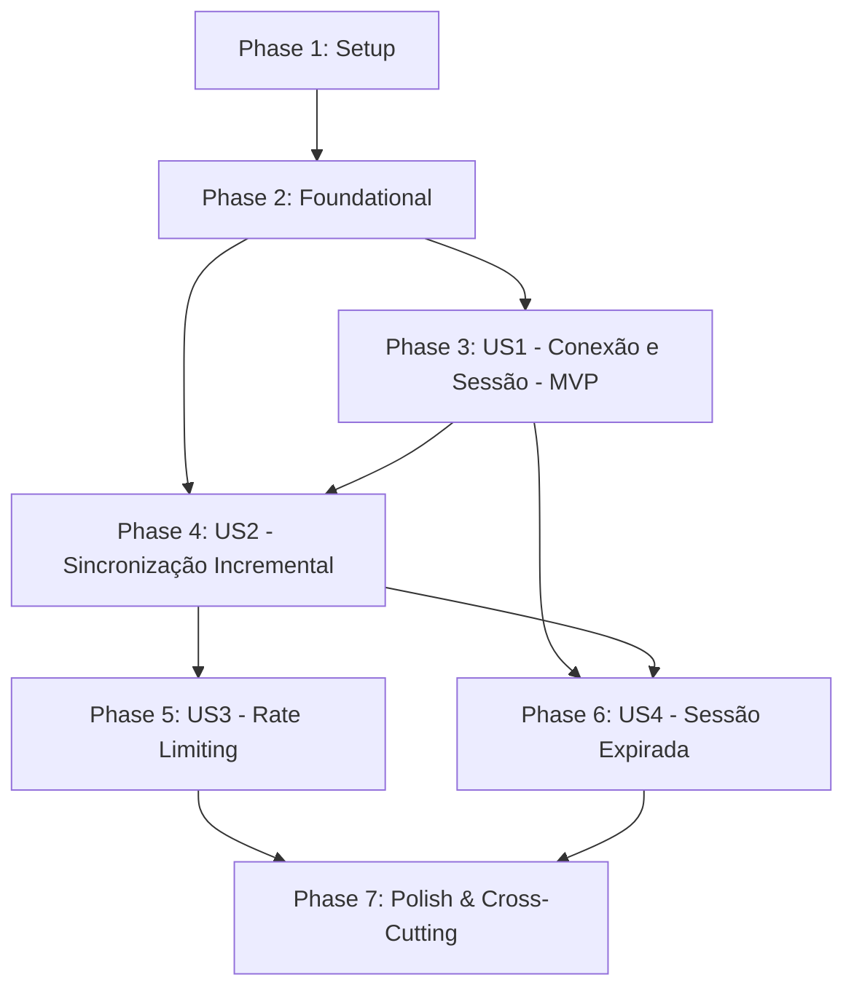

# Tasks: Conectar Conta e Sincronizar Músicas Curtidas do Spotify

**Input**: Documentos de design em `specs/001-sincronizar-curtidas-spotify/` (`spec.md`, `plan.md`, `research.md`, `data-model.md`, `contracts/`, `quickstart.md`).  
**Prerequisites**: `plan.md` e `spec.md` aprovados, conformidade com a Constituição v1.2.0.  
**Tests**: Testes são **obrigatórios** conforme o Princípio VIII da Constituição ("Cobertura completa é parte da definição de pronto: nenhuma tarefa está concluída sem seus testes").  
**Organization**: As tarefas são agrupadas estritamente por história de usuário para viabilizar implementação, testes e entrega incremental independente de cada fatia.

## Formato das Tarefas: `- [ ] [ID] [P?] [Story?] Descrição com caminho de arquivo`

- **[P]**: Tarefas paralelizáveis (arquivos distintos, sem dependência mútua direta).
- **[Story]**: Rótulo da história de usuário correspondente (`[US1]`, `[US2]`, `[US3]`, `[US4]`).
- Todas as tarefas especificam o caminho exato dos arquivos a criar ou modificar.

---

## Phase 1: Setup (Infraestrutura Compartilhada)

**Purpose**: Inicialização do projeto, dependências base do Maven e containers.

- [X] T001 Criar estrutura de diretórios e arquivos de configuração inicial do projeto em `pom.xml`, `.dockerignore`, `Dockerfile` e `docker-compose.yml`
- [X] T002 Configurar `pom.xml` com Java 21 LTS (`21.0.5`), Spring Boot `3.4.0`, dependências (`spring-boot-starter-web`, `spring-boot-starter-jdbc`, `flyway-core`, `sqlite-jdbc`, `wiremock-standalone`) e plugin JaCoCo com metas de falha de build (100% domínio, 90% backend linhas, 85% branches) e as 5 exclusões justificadas em `pom.xml`
- [X] T003 [P] Configurar propriedades da aplicação (porta 8888, URL do SQLite `/data/playlistmaker.db`, redirect URI `http://127.0.0.1:8888/api/auth/callback` e `SPOTIFY_CLIENT_ID` via env) em `src/main/resources/application.properties` e `src/test/resources/application-test.properties`
- [X] T004 [P] Criar migração DDL inicial do Flyway em `src/main/resources/db/migration/V1__criar_esquema_inicial.sql` definindo as tabelas `sessao_usuario`, `faixa_curtida` e `registro_sincronizacao` com constraints e índices conforme especificado em `data-model.md`

---

## Phase 2: Foundational (Pré-Requisitos Bloqueantes)

**Purpose**: Infraestrutura base que DEVE estar concluída antes da implementação das histórias de usuário.

**⚠️ CRITICAL**: Nenhuma tarefa das histórias de usuário pode iniciar sem a conclusão desta fase.

- [X] T005 Configurar `ConfiguracaoBancoDados.java` em `src/main/java/br/com/playlistmaker/adaptadores/saida/persistencia/sqlite/ConfiguracaoBancoDados.java` instanciando `DataSource` SQLite com foreign keys habilitadas e o bean `JdbcClient`
- [X] T006 [P] Criar hierarquia de exceções de domínio em `src/main/java/br/com/playlistmaker/core/dominio/excecoes/` (`SessaoInvalidaException.java`, `RateLimitExcedidoException.java`, `SpotifyPremiumRequeridoException.java` e `FalhaComunicacaoException.java`)
- [X] T007 [P] Implementar `TratadorGlobalExcecoes.java` em `src/main/java/br/com/playlistmaker/adaptadores/entrada/rest/TratadorGlobalExcecoes.java` mapeando exceções de domínio para respostas HTTP estruturadas em português (`ErroResponse`) conforme `contracts/auth-api.yaml` e `contracts/sync-api.yaml`
- [X] T008 [P] Configurar `ConfiguracaoSpotifyClient.java` em `src/main/java/br/com/playlistmaker/adaptadores/saida/spotify/ConfiguracaoSpotifyClient.java` instanciando bean `RestClient` base para comunicação HTTP com a API do Spotify
- [X] T009 [P] Criar fixtures JSON de respostas reais da API do Spotify em `src/test/resources/fixtures/spotify/` (`token-response.json`, `saved-tracks-page1.json`, `saved-tracks-page2.json`, `saved-tracks-com-arquivos-locais.json` e `rate-limit-429.json`)

**Checkpoint**: Fundação concluída — implementação das histórias de usuário pode prosseguir.

---

## Phase 3: User Story 1 - Conexão inicial da conta Spotify e persistência de sessão (Priority: P1) 🎯 MVP

**Goal**: Permitir que o único usuário conecte sua conta do Spotify via OAuth 2.0 PKCE com escopos mínimos (`user-library-read`, `playlist-modify-private`), persista a sessão no SQLite e mantenha a sessão ativa entre reinicializações sem pedir login a cada uso, tratando conta sem plano Premium ativo (`FR-017`).

**Independent Test**: Iniciar fluxo de conexão com PKCE, obter tokens no callback, persistir na base local e reiniciar a aplicação; verificar que `GET /api/auth/status` retorna `conectado: true` e `status: "ATIVO"` sem novas credenciais.

### Testes para User Story 1

- [X] T010 [P] [US1] Criar testes unitários para a entidade de sessão em `src/test/java/br/com/playlistmaker/core/dominio/SessaoUsuarioTest.java` cobrindo transições de estado (`ATIVO`, `EXPIRADO`, `REVOGADO`, `DESCONECTADO`) e cálculo de expiração de token
- [X] T011 [P] [US1] Criar testes unitários para `ServicoAutenticacaoTest.java` em `src/test/java/br/com/playlistmaker/core/servico/ServicoAutenticacaoTest.java` validando geração PKCE (verifier e challenge SHA-256), troca de código e renovação com refresh token
- [X] T012 [P] [US1] Criar testes de integração com WireMock em `src/test/java/br/com/playlistmaker/adaptadores/saida/spotify/AdaptadorSpotifyClientWireMockTest.java` simulando endpoints `/api/token` e validação de conta Premium em `/v1/me`
- [X] T013 [P] [US1] Criar testes de integração do repositório de sessão em `src/test/java/br/com/playlistmaker/adaptadores/saida/persistencia/sqlite/RepositorioSessaoSqliteTest.java` com SQLite real em arquivo temporário validando idempotência da sessão única (`id = 1`)

### Implementação para User Story 1

- [X] T014 [P] [US1] Implementar a entidade `SessaoUsuario.java` e o enum `EstadoSessao.java` em `src/main/java/br/com/playlistmaker/core/dominio/` respeitando as restrições de `data-model.md` para os campos `SessaoUsuario.id`, `SessaoUsuario.usuarioId`, `SessaoUsuario.accessToken`, `SessaoUsuario.refreshToken`, `SessaoUsuario.expiraEm`, `SessaoUsuario.atualizadoEm` e `SessaoUsuario.estado`
- [X] T015 [P] [US1] Definir a porta de entrada `CasoDeUsoAutenticacao.java` em `src/main/java/br/com/playlistmaker/core/porta/entrada/`, e as portas de saída `PortaSpotifyClient.java` (métodos de autorização, token e verificação de perfil) e `PortaRepositorioSessao.java` em `src/main/java/br/com/playlistmaker/core/porta/saida/`
- [X] T016 [US1] Implementar DTOs de token em `src/main/java/br/com/playlistmaker/adaptadores/saida/spotify/dto/SpotifyTokenResponseDTO.java` e métodos de troca de código PKCE, renovação de token e verificação de plano Premium (`FR-017`) em `src/main/java/br/com/playlistmaker/adaptadores/saida/spotify/AdaptadorSpotifyClient.java`
- [X] T017 [US1] Implementar `AdaptadorRepositorioSessaoSqlite.java` em `src/main/java/br/com/playlistmaker/adaptadores/saida/persistencia/sqlite/` persistindo e recuperando a sessão única (`id = 1`) no SQLite com `JdbcClient`
- [X] T018 [US1] Implementar o serviço de domínio `ServicoAutenticacao.java` em `src/main/java/br/com/playlistmaker/core/servico/` orquestrando o fluxo PKCE, validação de CSRF `state`, detecção de Premium ativo e renovação automática de credenciais
- [X] T019 [US1] Implementar DTOs REST (`RespostaStatusAuthDTO.java`, `RespostaLoginUrlDTO.java`) em `src/main/java/br/com/playlistmaker/adaptadores/entrada/rest/dto/` e o controller `ControladorAutenticacao.java` em `src/main/java/br/com/playlistmaker/adaptadores/entrada/rest/` expondo `/api/auth/status`, `/api/auth/login-url` e `/api/auth/callback` conforme `contracts/auth-api.yaml`
- [X] T020 [US1] Implementar teste automatizado de segurança de logs em `src/test/java/br/com/playlistmaker/seguranca/SegurancaLogsTest.java` com `OutputCaptureExtension` garantindo que `accessToken` e `refreshToken` jamais sejam impressos em logs (Princípio II e X)

**Checkpoint**: User Story 1 (MVP) concluída e testável de forma independente.

---

## Phase 4: User Story 2 - Sincronização incremental de músicas curtidas sob demanda (Priority: P1)

**Goal**: Permitir ao usuário autenticado disparar sob demanda a sincronização assíncrona em segundo plano das músicas curtidas para a base SQLite local, com lock de concorrência contra disparos simultâneos (HTTP 409), paginação resiliente (lotes de 50 faixas), descarte de arquivos locais, cálculo de delta de novas/removidas, registro de histórico (`FR-010`, `FR-011`), acompanhamento de progresso em tempo real (`FR-015`) e consulta local paginada.

**Independent Test**: Executar sincronização com 700+ faixas simuladas contendo arquivos locais; verificar descarte de arquivos locais, persistência das faixas com ID Spotify no banco, gravação do histórico com resumo, bloqueio de disparos simultâneos com 409 Conflict, e consulta paginada via `GET /api/curtidas` lendo exclusivamente do SQLite.

### Testes para User Story 2

- [ ] T021 [P] [US2] Criar testes unitários para as entidades `FaixaCurtidaTest.java` e `RegistroSincronizacaoTest.java` em `src/test/java/br/com/playlistmaker/core/dominio/` cobrindo construtores, invariantes de domínio e cálculo de resumo
- [ ] T022 [P] [US2] Criar testes unitários para `ServicoSincronizacaoTest.java` em `src/test/java/br/com/playlistmaker/core/servico/` cobrindo paginação de lotes, filtro de arquivos locais, inserção de novas faixas, deleção de faixas descurtidas e bloqueio de concorrência com `tryLock()`
- [ ] T023 [P] [US2] Criar testes de integração com WireMock em `src/test/java/br/com/playlistmaker/adaptadores/saida/spotify/AdaptadorSpotifyClientWireMockTest.java` cobrindo paginação de 50 em 50 faixas e filtro de `is_local = true` usando as fixtures `saved-tracks-page1.json`, `saved-tracks-page2.json` e `saved-tracks-com-arquivos-locais.json`
- [ ] T024 [P] [US2] Criar testes de integração para repositórios em `src/test/java/br/com/playlistmaker/adaptadores/saida/persistencia/sqlite/RepositoriosSqliteTest.java` validando upsert incremental de faixas, deleção de faixas ausentes por timestamp, consulta paginada e gravação do histórico

### Implementação para User Story 2

- [ ] T025 [P] [US2] Implementar as entidades de domínio `FaixaCurtida.java`, `RegistroSincronizacao.java`, `StatusSincronizacao.java` e `ResumoSincronizacao.java` em `src/main/java/br/com/playlistmaker/core/dominio/` respeitando rigorosamente as restrições de `data-model.md` para os campos `FaixaCurtida.id`, `FaixaCurtida.titulo`, `FaixaCurtida.artistas`, `FaixaCurtida.album`, `FaixaCurtida.duracaoMs`, `FaixaCurtida.curtidaEm`, `FaixaCurtida.sincronizadaEm`, `FaixaCurtida.fonte`, e para `RegistroSincronizacao.id`, `RegistroSincronizacao.iniciadoEm`, `RegistroSincronizacao.finalizadoEm`, `RegistroSincronizacao.status`, `RegistroSincronizacao.totalCurtidas`, `RegistroSincronizacao.novasFaixas`, `RegistroSincronizacao.removidasFaixas`, `RegistroSincronizacao.mensagem`, `RegistroSincronizacao.tempoEsperaSegundos` (atendendo aos requisitos FR-010 e FR-011)
- [ ] T026 [P] [US2] Definir a porta de entrada `CasoDeUsoSincronizacao.java` em `src/main/java/br/com/playlistmaker/core/porta/entrada/`, e as portas de saída `PortaRepositorioFaixas.java` e `PortaRepositorioHistorico.java` em `src/main/java/br/com/playlistmaker/core/porta/saida/`
- [ ] T027 [US2] Implementar DTOs de faixas do Spotify (`SpotifySavedTracksResponseDTO.java`, `SpotifySavedTrackItemDTO.java`) em `src/main/java/br/com/playlistmaker/adaptadores/saida/spotify/dto/` e método de busca paginada em `src/main/java/br/com/playlistmaker/adaptadores/saida/spotify/AdaptadorSpotifyClient.java` descartando silenciosamente faixas locais (`is_local: true` ou `id == null`)
- [ ] T028 [US2] Implementar repositórios SQLite `AdaptadorRepositorioFaixasSqlite.java` e `AdaptadorRepositorioHistoricoSqlite.java` em `src/main/java/br/com/playlistmaker/adaptadores/saida/persistencia/sqlite/` com SQL nativo (upsert de faixas, deleção delta pós-varredura, consulta paginada local e persistência de histórico)
- [ ] T029 [US2] Implementar `ServicoSincronizacao.java` em `src/main/java/br/com/playlistmaker/core/servico/` executando sincronização assíncrona em segundo plano, bloqueio concorrente com `ReentrantLock` (`tryLock()`), cálculo de delta de novas/removidas e atualização contínua do progresso (`FR-015`)
- [ ] T030 [US2] Implementar DTOs REST (`RespostaProgressoSyncDTO.java`, `RespostaFaixaLocalDTO.java`) em `src/main/java/br/com/playlistmaker/adaptadores/entrada/rest/dto/` e os controllers `ControladorSincronizacao.java` (`POST /api/sincronizacao` retornando 202 ou 409 Conflict, e `GET /api/sincronizacao/status`) e `ControladorCurtidas.java` (`GET /api/curtidas`) em `src/main/java/br/com/playlistmaker/adaptadores/entrada/rest/` conforme `contracts/sync-api.yaml`

**Checkpoint**: User Stories 1 e 2 plenamente operacionais e testáveis.

---

## Phase 5: User Story 3 - Tratamento de limitação de requisições (Rate Limit) (Priority: P2)

**Goal**: Garantir que respostas HTTP 429 da API do Spotify sejam tratadas com base no cabeçalho `Retry-After`: aguardando automaticamente em esperas curtas (<= 60s) e retomando a sincronização, ou suspendendo o processo em esperas prolongadas (> 60s) com notificação em português, assegurando que nova sincronização recomece do início de forma idempotente sem cursores intermediários (`FR-016`).

**Independent Test**: Simular resposta 429 com `Retry-After <= 60s` e confirmar retomada automática; simular 429 com `Retry-After > 60s` e confirmar suspensão com status `LIMITADO`, preservação das faixas gravadas e mensagem com o tempo de espera.

### Testes para User Story 3

- [ ] T031 [P] [US3] Criar testes unitários para a política de Rate Limit em `src/test/java/br/com/playlistmaker/core/servico/RateLimitPoliticaTest.java` validando decisão de espera (<= 60s) vs suspensão (> 60s) e retentativas máximas
- [ ] T032 [P] [US3] Criar testes de integração com WireMock em `src/test/java/br/com/playlistmaker/adaptadores/saida/spotify/RateLimitWireMockTest.java` com a fixture `rate-limit-429.json` validando leitura do cabeçalho `Retry-After`

### Implementação para User Story 3

- [ ] T033 [US3] Implementar interceptor e tratamento de HTTP 429 com leitura do cabeçalho `Retry-After` em `src/main/java/br/com/playlistmaker/adaptadores/saida/spotify/AdaptadorSpotifyClient.java`
- [ ] T034 [US3] Integrar a política de Rate Limit em `ServicoSincronizacao.java` atualizando `RegistroSincronizacao` com status `LIMITADO` e `tempoEsperaSegundos`, e garantindo que nova execução posterior execute sincronização completa idempotente sem depender de cursores parciais (`FR-013`, `FR-014`, `FR-016`)

**Checkpoint**: User Stories 1, 2 e 3 integradas e resilientes a limites de cota da API.

---

## Phase 6: User Story 4 - Tratamento e recuperação de sessão expirada ou revogada (Priority: P2)

**Goal**: Detectar expiração definitiva ou revogação de credenciais do Spotify durante qualquer operação, apresentar mensagem amigável e acionável em português orientando nova conexão, marcar a sessão como expirada no banco e preservar intacto o acervo de faixas locais já sincronizado (`FR-004`).

**Independent Test**: Invalidar credencial ou simular resposta 401/`invalid_grant`; ao tentar sincronizar, verificar que a resposta HTTP indica sessão expirada, o estado de `SessaoUsuario` muda para `EXPIRADO` e as faixas locais previamente salvas permanecem inalteradas.

### Testes para User Story 4

- [ ] T035 [P] [US4] Criar testes unitários de recuperação de sessão em `src/test/java/br/com/playlistmaker/core/servico/SessaoExpiradaRecuperacaoTest.java` simulando falha de renovação de refresh token e revogação de acesso
- [ ] T036 [P] [US4] Criar testes de integração com WireMock em `src/test/java/br/com/playlistmaker/adaptadores/saida/spotify/TokenRevogadoWireMockTest.java` simulando erro 401 e `invalid_grant` nas chamadas ao Spotify

### Implementação para User Story 4

- [ ] T037 [US4] Implementar tratamento de erro de credencial inválida/revogada em `src/main/java/br/com/playlistmaker/core/servico/ServicoAutenticacao.java` e `ServicoSincronizacao.java`, atualizando o estado de `SessaoUsuario.estado` para `EXPIRADO` no SQLite preservando as faixas em `faixa_curtida`
- [ ] T038 [US4] Integrar mensagem acionável em português ("Sessão expirada. Faça login de novo.") no `src/main/java/br/com/playlistmaker/adaptadores/entrada/rest/TratadorGlobalExcecoes.java` retornando status `401 Unauthorized` com código `SESSAO_EXPIRADA` conforme `contracts/auth-api.yaml` e `contracts/sync-api.yaml`

**Checkpoint**: Todas as 4 histórias de usuário totalmente implementadas e protegidas.

---

## Phase 7: Polish & Cross-Cutting Concerns

**Purpose**: Teste ponta a ponta, validação de cobertura JaCoCo, empacotamento Docker e validação de quickstart.

- [ ] T039 Implementar teste ponta a ponta simulado em `src/test/java/br/com/playlistmaker/e2e/FluxoConexaoESincronizacaoE2ETest.java` cobrindo o fluxo completo com WireMock: autorização PKCE -> sincronização de 700+ faixas -> consulta da base local -> reinicialização simulada com verificação de persistência
- [ ] T040 Executar `mvn clean verify` e verificar que todas as metas de cobertura do JaCoCo foram atendidas (100% de linhas e branches no domínio, 90% linhas e 85% branches no backend geral) com as 5 exclusões justificadas registradas em `pom.xml`
- [ ] T041 [P] Configurar `.dockerignore` na raiz do projeto excluindo `.git/`, `.env*`, `target/`, bancos locais e arquivos de especificação conforme `research.md`
- [ ] T042 [P] Configurar `Dockerfile` multi-estágio (`maven:3.9.9-eclipse-temurin-21` e `eclipse-temurin:21.0.5_11-jre-jammy`) e `docker-compose.yml` com volume nomeado `playlistmaker_sqlite_data:/data` e publicação restrita a `127.0.0.1:8888:8888`
- [ ] T043 Executar os cenários de validação descritos em `specs/001-sincronizar-curtidas-spotify/quickstart.md` e confirmar operação de ponta a ponta

---

## Dependencies & Execution Order

### Phase Dependencies

- **Phase 1 (Setup)**: Pode iniciar imediatamente.
- **Phase 2 (Foundational)**: Depende da Phase 1 e **bloqueia** todas as histórias de usuário.
- **Phase 3 (User Story 1 - MVP)**: Depende da Phase 2. Entrega o primeiro incremento de valor testável (conexão da conta e persistência).
- **Phase 4 (User Story 2)**: Depende da Phase 2 e integra com a sessão da Phase 3. Permite sincronizar faixas sob demanda.
- **Phase 5 (User Story 3)**: Depende da Phase 4. Agrega resiliência e tratamento de 429 Retry-After à sincronização.
- **Phase 6 (User Story 4)**: Depende das Phases 3 e 4. Trata a recuperação graciosa de sessão expirada mantendo os dados locais intactos.
- **Phase 7 (Polish)**: Depende da conclusão de todas as histórias desejadas.

---

## Oportunidades de Execução Paralela

1. **Na Phase 1 (Setup)**:
   - `T003` (propriedades) e `T004` (migração Flyway) podem rodar em paralelo após `T001`/`T002`.
2. **Na Phase 2 (Foundational)**:
   - `T006` (exceções), `T007` (tratador de erros), `T008` (configuração do RestClient) e `T009` (fixtures JSON) podem rodar simultaneamente.
3. **Na Phase 3 (US1)**:
   - Os testes `T010`, `T011`, `T012` e `T013` podem ser criados em paralelo antes da implementação.
   - Os modelos e interfaces `T014` e `T015` podem ser criados em paralelo.
4. **Na Phase 4 (US2)**:
   - Os testes `T021`, `T022`, `T023` e `T024` podem ser desenvolvidos em paralelo.
   - As entidades `T025` e interfaces `T026` rodam em paralelo.
5. **Na Phase 7 (Polish)**:
   - `T041` (`.dockerignore`) e `T042` (`Dockerfile` e `docker-compose.yml`) podem ser configurados em paralelo.

---

## Implementation Strategy

### MVP First (User Story 1 Apenas)
1. Concluir Phase 1 (Setup) e Phase 2 (Foundational).
2. Concluir Phase 3 (User Story 1): autorização PKCE, troca de tokens, verificação de Premium e persistência segura no SQLite.
3. **Validar MVP**: Executar testes unitários e de integração de US1 e testar login no navegador com `GET /api/auth/status`.

### Entrega Incremental
1. MVP entregue (US1) -> Conexão da conta operacional e persistida.
2. Adicionar US2 -> Sincronização incremental de 700+ músicas, descarte de locais, cálculo de resumo e consulta local sem dependência externa.
3. Adicionar US3 -> Resiliência a Rate Limit (HTTP 429) e retomada idempotente.
4. Adicionar US4 -> Tratamento gracioso de sessão expirada preservando os dados locais.
5. Polish -> E2E completo, verificação JaCoCo (`mvn verify`) e validação de container Docker.
